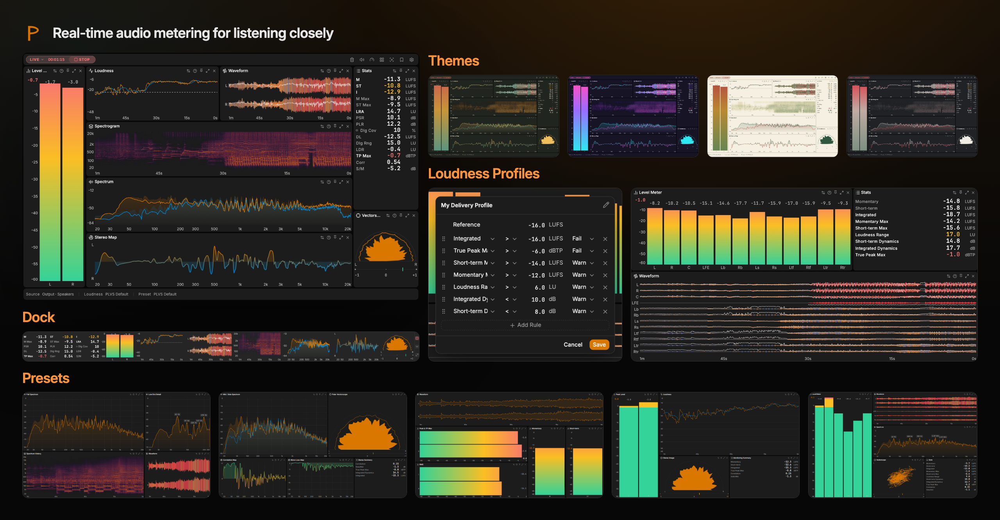

  

## PLVS — Real-time audio metering

A desktop companion that keeps your audio's level, shape, and movement in view.

[Website](https://plvs.soundoer.com) ·
[User Guide](https://plvs.soundoer.com/docs/) ·
[Contribute](https://github.com/SounDoer/PLVS/blob/main/CONTRIBUTING.md)
